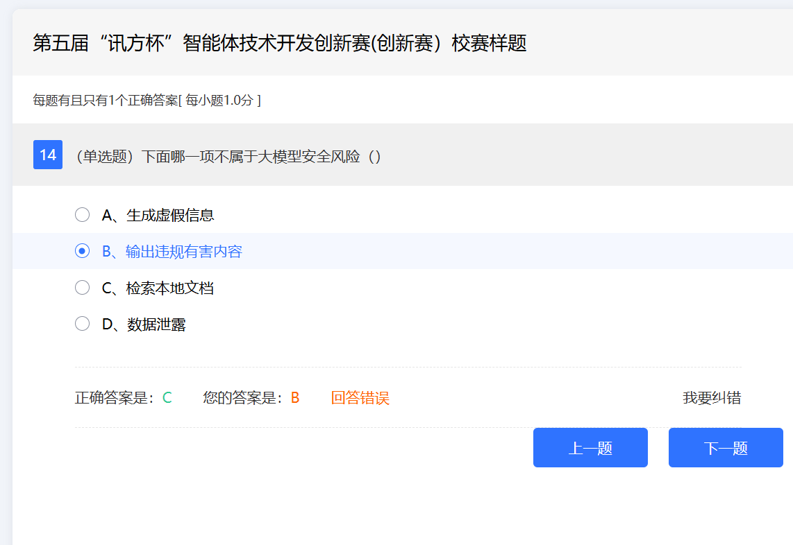

# 讯方杯校赛样题 · 知识点总结

> **来源**：第五届“讯方杯”智能体技术开发创新赛（创新赛）校赛样题
> **题型规则**：单选题，每题有且只有 1 个正确答案，每小题 1.0 分
> **整理日期**：2026-11-27（持续更新）
> **已收录**：29 道错题（16 道单选 + 13 道多选）
> **使用说明**：先查「错题索引」定位题号，再到对应模块看「题目还原 → 正确答案 → 核心解析 → 易错点」；文末有跨题串讲与复习优先级。截图副本存于 `assets/qNN.png`。

## 错题索引

| 题号 | 知识点 | 正确答案 | 我的答案 | 状态 |
| --- | --- | --- | --- | --- |
| 14 | 大模型安全风险的分类与辨析（单选） | C | B | ❌ 已订正，重点复习 |
| 17 | Python 模块导入关键字（单选） | A | B | ❌ 已订正 |
| 21 | Python 异常处理关键字（单选） | B | A | ❌ 已订正 |
| 22 | 不可变数据类型（单选） | C | D | ❌ 已订正，重点复习 |
| 31 | 工具调用失败原因排查（单选） | C | D | ❌ 已订正，重点复习 |
| 32 | RAG 相似度算法（单选） | D | A | ❌ 已订正 |
| 35 | 智能体测试评估重点（单选） | D | B | ❌ 已订正，重点复习 |
| 39 | 智能体常用框架辨析（单选） | D | B | ❌ 已订正 |
| 43 | RAG 流程第一步（单选） | D | A | ❌ 已订正 |
| 54 | Python 内置模块（单选） | D | C | ❌ 已订正 |
| 55 | 列表追加元素方法（单选） | B | A | ❌ 已订正 |
| 57 | 文件打开模式（单选） | B | D | ❌ 已订正 |
| 59 | 类的构造方法（单选） | A | B | ❌ 已订正 |
| 62 | 元组 tuple 特点（单选） | B | C | ❌ 已订正 |
| 73 | 大语言模型网络结构（单选） | B | C | ❌ 已订正 |
| 75 | 过拟合与欠拟合（单选） | B | A | ❌ 已订正，重点复习 |
| 79 | Embedding 向量模型作用（多选） | ABC | ABD | ❌ 已订正，重点复习 |
| 81 | RAG 优化手段（多选） | ABC | ABCD | ❌ 已订正 |
| 83 | 智能体测试评估维度（多选） | ABCD | ACD | ❌ 已订正 |
| 85 | 工具定义信息（多选） | ABCD | AB | ❌ 已订正 |
| 86 | 智能体记忆分类（多选） | ABC | ABD | ❌ 已订正 |
| 87 | 智能体开发常用框架（多选） | ABC | ABD | ❌ 已订正 |
| 88 | 工具调用适用场景（多选） | ABC | AC | ❌ 已订正 |
| 89 | 提示词注入风险场景（多选） | ABD | ACD | ❌ 已订正，重点复习 |
| 91 | RAG 核心环节（多选） | ABCD | BCD | ❌ 已订正 |
| 93 | 优秀提示词设计技巧（多选） | ABCD | ABD | ❌ 已订正 |
| 94 | Python 面向对象核心概念（多选） | ABCD | AB | ❌ 已订正 |
| 98 | 智能体核心要素（多选） | ABCD | ABD | ❌ 已订正 |
| 99 | Transformer 核心设计（多选） | ABC | BC | ❌ 已订正，重点复习 |

---

## 第 14 题 · 大模型安全风险

### 题目还原

**（单选题）下面哪一项不属于大模型安全风险（ ）**

- A、生成虚假信息
- B、输出违规有害内容
- C、检索本地文档
- D、数据泄露

> 正确答案是：**C**　您的答案是：**B**　回答错误



### 答案与结论

**正确答案：C（检索本地文档）。**

A、B、D 描述的都是大模型可能产生的不良后果，属于安全风险；C 描述的是一项**功能/能力**（RAG 检索增强生成中的知识库检索动作），本身不是风险类别，因此是“不属于”的那一项。

### 逐项解析

| 选项 | 是否属于风险 | 归属类别 | 说明 |
| --- | --- | --- | --- |
| A 生成虚假信息 | ✅ 属于 | 内容安全 / 事实可信度 | 即“幻觉”：编造事实、伪造引用、给出错误结论，可能误导决策、传播谣言、造成法律与声誉损失 |
| B 输出违规有害内容 | ✅ 属于 | 内容安全 / 合规 | **最典型的内容安全风险**：涉黄涉暴、违法犯罪指导、仇恨歧视、恶意代码、被越狱后输出违禁内容。我错选了它 |
| C 检索本地文档 | ❌ 不属于 | ——（能力，非风险） | RAG / 知识库检索能力：把私有文档切片、向量化后召回，拼进上下文辅助生成。其作用是**缓解幻觉、补充私有知识**，方向上甚至是“降低风险”的手段 |
| D 数据泄露 | ✅ 属于 | 数据安全 / 隐私保护 | 训练语料、对话记录、提示词中的敏感信息（PII、商业秘密）被模型记忆、回显，或经接口/日志外泄 |

> ⚠️ **严谨边界**：C 说的是“检索”这个动作，不是风险；但如果实现不当——知识库权限不隔离、把含敏感信息的文档无差别送进上下文、检索结果未脱敏——就会**间接引发 D（数据泄露）**。考试按“动作本身 ≠ 风险类别”判定，工程上仍要做权限与脱敏控制。

---

### 核心知识点：大模型安全风险的常见分类

```
大模型安全风险
├── 1. 内容安全（输出侧）
│     ├── 违规有害内容：违法、暴恐、色情、仇恨歧视
│     ├── 虚假信息 / 幻觉：事实错误、伪造引用
│     └── 偏见与价值观偏差
├── 2. 数据与隐私安全
│     ├── 数据泄露：敏感信息被记忆、回显、外传
│     ├── 训练数据合规：未授权采集、版权问题
│     └── 数据投毒：污染训练/知识库数据以操纵输出
├── 3. 模型自身安全
│     ├── 对抗样本、鲁棒性不足
│     ├── 后门 / 模型投毒、模型窃取与逆向
│     └── 越狱（Jailbreak）：绕过安全对齐
├── 4. 应用与系统安全（智能体场景高频）
│     ├── 提示注入（Prompt Injection）：恶意指令劫持模型行为
│     ├── 插件 / 工具调用被滥用、越权访问外部系统
│     └── 拒服与资源耗尽、依赖组件漏洞
└── 5. 合规、伦理与滥用
      ├── 被用于诈骗、钓鱼、恶意代码生成
      └── 责任归属、可追溯性与审计缺失
```

**对应关系速查**：A → 第 1 类；B → 第 1 类；D → 第 2 类；C → 不在任何一类，它是 RAG 能力。

### 本题陷阱与易错点

1. **否定式题干**：问的是“**不属于**”，容易惯性挑一个最像风险的选项。看到“不属于 / 不包括 / 错误的是”先圈出来。
2. **把「能力」混进「风险」清单**：命题常用手法是三个风险 + 一个中性功能（检索、微调、向量化、工具调用、缓存等）。判别口诀：**风险看后果，功能看动作**——“虚假信息、违规内容、数据泄露”都是不良后果；“检索文档”只是一个中性动作。
3. **误判 B 的心理**：容易想成“模型本来就可能输出这些内容，算不上风险”。但题干描述的是需要防范的**风险现象**，不是产品功能；输出违规有害内容恰恰是内容治理的首要对象。
4. **别反向加戏**：C 在工程上确实可能带来泄露隐患，但单选题取“最直接、最本质的归类”，不能因为存在间接关联就把它判成风险。

### 关联考点（容易一起考）

- **RAG 检索增强生成**：流程为「文档切片 → 向量化入库 → 相似度检索 → 拼接上下文 → 模型生成」；主要价值是缓解幻觉、接入私有知识、可不改模型即可更新知识。
- **提示注入 vs 越狱**：提示注入是外部内容携带恶意指令劫持模型（含直接/间接注入）；越狱是通过角色扮演、编码、分步诱导等绕过安全对齐。前者重在“谁在指挥模型”，后者重在“突破限制”。
- **智能体场景的数据泄露通道**：工具/插件调用参数、对话日志与链路追踪、上下文拼接、长期记忆、知识库权限越界、第三方 API 传参。
- **常见防护措施**：输入与输出双向内容审核、敏感信息脱敏、最小权限与知识库隔离、检索结果过滤、安全对齐（RLHF/规则）、人工复核高危操作、全链路审计。

### 自测题

1. 下列属于「模型自身安全」而非「内容安全」的是？
   A. 生成虚假新闻　B. 输出仇恨言论　C. 被对抗样本诱导误判　D. 回显用户身份证号
2. 智能体接入企业知识库时，最应优先防范的是？
   A. 检索速度慢　B. 无权限隔离导致跨部门敏感文档被召回　C. 文档切片过长　D. 向量维度不足
3. 攻击者在网页中埋入隐藏指令，使读取该网页的模型转而执行攻击者命令，这属于？
   A. 越狱　B. 间接提示注入　C. 数据投毒　D. 模型窃取

<details>
<summary>参考答案</summary>

1. **C**（A、B 属内容安全，D 属数据安全；对抗样本属模型鲁棒性/自身安全）
2. **B**（本质是数据泄露与越权访问，对应本题 D 类风险）
3. **B**（外部内容夹带指令 = 间接提示注入；越狱是绕过安全对齐的话术诱导，数据投毒针对训练/知识库数据）

</details>

### 一句话记忆

> **三大风险记后果：假信息、坏内容、漏数据；“检索本地文档”是 RAG 的本事，不是风险。**

---

## 模块一 · Python 编程基础（第 17、21、22、54、55、57、59、62、94 题）

## 第 17 题 · Python 模块导入

**（单选题）导入 Python 模块使用哪个关键字（ ）**

- A、from import
- B、include
- C、require
- D、using

> 正确答案是：**A**　您的答案是：**B**　回答错误
> [原题截图](assets/q17.png)

**解析**：Python 的导入语句是 `import 模块名` 或 `from 模块名 import 成员名`，`from ... import ...` 是关键字组合。`include`（C/C++）、`require`（Node.js）、`using`（C#/Java）都是其他语言的导入关键字。

**易错点**：把其他语言的导入关键字串到 Python 上。记牢：Python 只有 **import / from...import** 这一套。

---

## 第 21 题 · Python 异常处理

**（单选题）Python 中用于捕获异常的关键字是（ ）**

- A、if
- B、try
- C、for
- D、def

> 正确答案是：**B**　您的答案是：**A**　回答错误
> [原题截图](assets/q21.png)

**解析**：异常处理结构为 `try ... except ... else ... finally`：`try` 包裹可能出错的代码，`except` 捕获并处理异常。`if` 是条件分支，`for` 是循环，`def` 定义函数，均与异常无关。

**易错点**：严格说 `except` 才是"捕获子句"，但选项中没有 except，故取代表异常机制的 `try`。记住四件套：**try 试探、except 捕获、else 无异常执行、finally 必执行**。

---

## 第 22 题 · 可变与不可变数据类型

**（单选题）在 Python 中，以下哪个是不可变数据类型（ ）**

- A、list
- B、dict
- C、tuple
- D、set

> 正确答案是：**C**　您的答案是：**D**　回答错误
> [原题截图](assets/q22.png)

**解析**：
- **不可变**：int、float、str、bool、**tuple**、frozenset
- **可变**：**list**、**dict**、**set**

`set` 虽然元素唯一，但本身可 `add()` / `remove()`，所以是可变类型。另注意：dict 的键必须是可哈希（通常不可变）的对象，如 str、tuple。

**易错点**：把 set 的"元素不重复"误当成"不可变"。与第 62 题呼应。

---

## 第 54 题 · Python 内置模块

**（单选题）下面属于 Python 内置模块的是（ ）**

- A、numpy
- B、torch
- C、langchain
- D、os

> 正确答案是：**D**　您的答案是：**C**　回答错误
> [原题截图](assets/q54.png)

**解析**：内置模块（标准库）随解释器自带，无需安装：`os`、`sys`、`math`、`json`、`time`、`random`、`re`、`datetime`、`collections` 等。`numpy`（科学计算）、`torch`（深度学习）、`langchain`（智能体框架）都是第三方库，需 pip 安装。

**易错点**：langchain 名字像"底层库"但不是标准库；看到 numpy/torch/langchain 一律归为第三方。

---

## 第 55 题 · 列表追加元素

**（单选题）Python 中，列表追加元素的方法是（ ）**

- A、add()
- B、append()
- C、push()
- D、insert()

> 正确答案是：**B**　您的答案是：**A**　回答错误
> [原题截图](assets/q55.png)

**解析**：`list.append(x)` 在尾部追加单个元素（均摊 O(1)）；`list.insert(i, x)` 在指定下标插入（O(n)）；`list.extend(iterable)` 批量追加。`add()` 是 **set** 的方法，`push()` 是栈的抽象操作（Python 用 append 模拟）。

**易错点**：add 对应集合、push 对应栈、append 对应列表——按"容器类型 → 方法"配对记；insert 需要位置参数，不是单纯追加。

---

## 第 57 题 · 文件打开模式

**（单选题）使用 open 读取文件，模式 'r' 代表（ ）**

- A、只写
- B、只读
- C、追加写入
- D、二进制写入

> 正确答案是：**B**　您的答案是：**D**　回答错误
> [原题截图](assets/q57.png)

**解析**：`r` = read **只读**（默认模式，文件必须存在）；`w` = write 只写并覆盖；`a` = append 追加写入；加 `b` 才是二进制（`rb`/`wb`）；`r+` 为读写。

**易错点**：二进制写入是 `wb`，不是 `r`；`b` 只是修饰符，必须和 r/w/a 组合。

---

## 第 59 题 · 类的构造方法

**（单选题）Python 面向对象中，代表类的构造方法的是（ ）**

- A、init
- B、del
- C、main
- D、start

> 正确答案是：**A**　您的答案是：**B**　回答错误
> [原题截图](assets/q59.png)

**解析**：`__init__` 是初始化方法（通常称构造方法），创建实例时自动调用，第一个参数为 `self`；`__del__` 是析构方法（对象销毁时调用）；`main` 不是 Python 关键字，常见写法是 `if __name__ == '__main__':` 作为程序入口；`start` 无特殊含义。

**易错点**：init（构造/初始化）与 del（析构）方向相反，别选反。严谨来说 `__new__` 负责创建对象、`__init__` 负责初始化，但考试按惯例取 `__init__`。

---

## 第 62 题 · 元组 tuple 的特点

**（单选题）下列属于 Python 元组 tuple 特点的是（ ）**

- A、可以增删元素
- B、不可修改元素
- C、可以用 append
- D、无序

> 正确答案是：**B**　您的答案是：**C**　回答错误
> [原题截图](assets/q62.png)

**解析**：tuple 是**有序**、**不可变**的序列：不能增删改元素，没有 `append()` 方法；但支持索引、切片、遍历，且当所有元素可哈希时自身也可哈希（可作 dict 的键）。

**易错点**：把"不可变"误解成"无序"——tuple 和 list 一样是有序序列；append 是 list 专属。与第 22 题互为印证。

---

## 第 94 题 · 面向对象核心概念（多选）

**（多选题）Python 面向对象中，包含的核心概念有（ ）**

- A、类
- B、对象
- C、属性
- D、方法

> 正确答案是：**ABCD**　您的答案是：**AB**　回答错误
> [原题截图](assets/q94.png)

**解析**：
- **类（Class）**：对象的模板/蓝图，定义属性与方法
- **对象（Object）**：类的实例，拥有独立状态
- **属性（Attribute）**：对象/类的数据成员，描述状态
- **方法（Method）**：定义在类中的函数，描述行为

四者共同构成 OOP 的核心概念，缺一不可。

**易错点**：漏选 C、D——把"属性、方法"当成类的细节而非核心概念。记一句：**类与对象是"是什么"，属性与方法是"有什么、能做什么"**。与第 59 题（`__init__` 构造方法）联动复习。

---

## 模块二 · 机器学习与深度学习基础（第 73、75、99 题）

## 第 73 题 · 大语言模型的网络结构

**（单选题）大语言模型主要是基于哪类神经网络结构发展而来（ ）**

- A、CNN 卷积网络
- B、Transformer
- C、RNN 循环网络
- D、GAN 生成对抗网络

> 正确答案是：**B**　您的答案是：**C**　回答错误
> [原题截图](assets/q73.png)

**解析**：主流大语言模型（GPT、LLaMA 等）基于 **Transformer** 架构（多为 Decoder-only）。Transformer 以自注意力为核心，能捕捉长距离依赖且支持并行训练，这是扩展到超大规模模型的关键。CNN 主攻视觉，RNN 处理序列但难以并行且有长依赖衰减问题，GAN 用于生成对抗。

**易错点**：RNN 也是序列模型，容易被"语言是序列"带偏。记住关键词：**大语言模型 → Transformer**。与第 99 题联动。

---

## 第 75 题 · 过拟合与欠拟合

**（单选题）机器学习中，模型在训练集表现很好、新数据上效果很差的现象称为（ ）**

- A、欠拟合
- B、过拟合
- C、正则化
- D、归一化

> 正确答案是：**B**　您的答案是：**A**　回答错误
> [原题截图](assets/q75.png)

**解析**：
- **过拟合**：训练误差小、测试误差大——模型连训练噪声都记住了，泛化能力差
- **欠拟合**：训练集和测试集表现都差——模型能力不足或训练不够
- **正则化**（L1/L2、Dropout、早停、数据增强）是缓解过拟合的手段
- **归一化**是特征缩放，加速收敛

**易错点**：欠/过拟合方向记反。口诀：**训练差＝欠拟合，训练好但新数据差＝过拟合**。

---

## 第 99 题 · Transformer 核心设计（多选）

**（多选题）大语言模型能力依赖 Transformer 的哪些核心设计（ ）**

- A、自注意力机制
- B、位置编码
- C、前馈神经网络
- D、卷积池化层

> 正确答案是：**ABC**　您的答案是：**BC**　回答错误
> [原题截图](assets/q99.png)

**解析**：Transformer 编码器/解码器层由**自注意力 + 前馈神经网络**两大子层构成，配合残差连接与层归一化；**位置编码**注入顺序信息（自注意力本身不含位置概念）。卷积池化层属于 CNN，不是 Transformer 的组成。

**易错点**：漏选 A——**自注意力是 Transformer 最核心的设计**，绝不能漏；选 D 则是把 CNN 组件混进来。与第 73 题联动记忆。

---

## 模块三 · RAG 与 Embedding 技术链（第 32、43、79、81、91 题）

## 第 32 题 · RAG 检索的相似度算法

**（单选题）在 RAG 检索阶段，使用什么算法计算文本相似度（ ）**

- A、快速傅里叶变换
- B、哈希加密
- C、冒泡排序
- D、余弦相似度

> 正确答案是：**D**　您的答案是：**A**　回答错误
> [原题截图](assets/q32.png)

**解析**：向量检索的相似度度量常用**余弦相似度**（关注向量方向，消除模长影响）、点积、欧氏距离；工程上配合 HNSW/IVF 等近似最近邻索引。快速傅里叶变换用于信号处理，哈希加密用于安全，冒泡排序是排序算法，都与语义相似度无关。

**易错点**：把"计算相似度"泛化成"某种算法名"就选了 FFT。记住：**向量检索 = 余弦相似度 / 点积 / 欧氏距离**。

---

## 第 43 题 · RAG 流程第一步

**（单选题）RAG 流程第一步一般是（ ）**

- A、向量检索
- B、LLM 生成回答
- C、输出结果
- D、向量化文档入库

> 正确答案是：**D**　您的答案是：**A**　回答错误
> [原题截图](assets/q43.png)

**解析**：
- **离线建库**：文档切片 → 向量化（Embedding）→ 入库
- **在线问答**：Query 向量化 → 相似度检索 → 拼接上下文 → LLM 生成 → 输出

第一步是"向量化文档入库"（更前面还有文档切片）。本题从选项看，D 是起点。

**易错点**：把"在线检索"当成第一步。RAG 必须先有知识库，才能检索。与第 91 题（四环节全选）联动。

---

## 第 79 题 · Embedding 向量模型的作用（多选）

**（多选题）Embedding 向量模型的作用描述正确的是（ ）**

- A、将非结构化文本转为稠密向量
- B、用来计算文本之间语义相似度
- C、不负责生成自然语言回答
- D、可以替代大模型做逻辑推理

> 正确答案是：**ABC**　您的答案是：**ABD**　回答错误
> [原题截图](assets/q79.png)

**解析**：Embedding 模型把文本映射为稠密向量，语义相近的文本在向量空间中距离近，因此可用于召回与相似度计算（A、B 正确）。它是**表示模型**，不负责自然语言生成（C 是"不负责"，表述正确），更不能替代 LLM 做复杂逻辑推理（D 错误）。

**易错点**：
1. D 把"表示"夸大成"推理"，Embedding 只是 RAG 的一环，不是大脑。
2. **C 是否定式表述但内容是事实**——"不负责生成"是对的，容易因为不敢选否定句而漏掉。这类题要按事实判断，不按句式判断。

---

## 第 81 题 · RAG 优化手段（多选）

**（多选题）RAG 优化手段包含（ ）**

- A、文档合理分块
- B、多路检索
- C、重排 Rerank
- D、增大输入窗口不做检索

> 正确答案是：**ABC**　您的答案是：**ABCD**　回答错误
> [原题截图](assets/q81.png)

**解析**：
- **文档分块**：控制 chunk 大小与重叠，或按语义/结构切分，直接影响召回质量
- **多路检索**：关键词检索 + 向量检索混合、多 Query 改写，提升召回率
- **重排 Rerank**：用 Cross-Encoder 对候选片段精排，提升注入上下文的精度
- D"增大输入窗口不做检索"等于放弃 RAG 的核心机制，长上下文不等于检索，成本高且噪声大

**易错点**：D 常被包装成"长上下文新方案"来迷惑，但题目问的是 **RAG 优化**，不检索就不叫 RAG。

---

## 第 91 题 · RAG 核心环节（多选）

**（多选题）RAG 检索增强生成包含哪些核心环节（ ）**

- A、文档切片
- B、向量化入库
- C、用户 Query 向量化 + 相似度检索
- D、检索结果送入 LLM 生成

> 正确答案是：**ABCD**　您的答案是：**BCD**　回答错误
> [原题截图](assets/q91.png)

**解析**：完整 RAG 链路四环节缺一不可：**切片 → 向量化入库 → Query 向量化并检索 → 结果送入 LLM 生成**。A 文档切片是建库的前置步骤，属于核心环节。

**易错点**：漏选 A——把"文档切片"当成不起眼的预处理细节。它与第 43 题呼应：第 43 题问第一步，选项中"向量化文档入库"已隐含切片在前。

---

## 模块四 · 智能体架构、工具与评估（第 31、35、39、83、85、86、87、88、98 题）

## 第 31 题 · 工具调用失败原因排查

**（单选题）一个智能体调用工具失败，最不可能的原因是（ ）**

- A、提示词没有正确描述工具参数
- B、工具入参格式不符合接口要求
- C、向量库文档太多
- D、Function Calling 格式错误

> 正确答案是：**C**　您的答案是：**D**　回答错误
> [原题截图](assets/q31.png)

**解析**：A（工具描述不清 → 模型填错参数）、B（入参不符合接口要求 → 调用被拒）、D（Function Calling 格式错误 → 无法解析）都是工具调用链路上的典型故障。C 向量库文档多少影响的是**检索**质量与速度，和"工具调用"无直接因果关系，故为最不可能。

**易错点**：题干问"**最不可能**"，D 恰恰是最可能的常见原因，容易反向选错。先圈出否定词，再逐个判断"是否在同一条链路上"。

---

## 第 35 题 · 智能体测试评估重点

**（单选题）智能体测试评估，下面哪项不是评估重点（ ）**

- A、任务能否正确完成
- B、是否出现幻觉、错误调用工具
- C、回答是否符合格式约束
- D、模型文件大小

> 正确答案是：**D**　您的答案是：**B**　回答错误
> [原题截图](assets/q35.png)

**解析**：评估聚焦**效果与行为**：任务成功率（A）、幻觉率与工具调用正确率（B）、格式合规性（C），还有安全性与成本时延。模型文件大小是部署/资源指标，不是智能体效果的评估重点。

**易错点**：B 正是核心评估项，却误选了它。与第 83 题互为镜像——那题问"评估维度包含哪些"，B（幻觉率）必须选。

---

## 第 39 题 · 智能体常用开发框架辨析

**（单选题）不属于智能体常用开发框架的是（ ）**

- A、LangChain
- B、LlamaIndex
- C、AutoGen
- D、MySQL

> 正确答案是：**D**　您的答案是：**B**　回答错误
> [原题截图](assets/q39.png)

**解析**：LangChain（链式编排、工具与记忆）、LlamaIndex（RAG 数据索引与检索）、AutoGen（多智能体协作）都是智能体开发框架；MySQL 是关系型数据库，只是可选的存储组件，不是智能体框架。

**易错点**：LlamaIndex 名字陌生被当成干扰项。记 **Index → 索引 → RAG 框架**。与第 87 题联动。

---

## 第 83 题 · 智能体测试评估维度（多选）

**（多选题）智能体测试评估维度包含（ ）**

- A、任务完成成功率
- B、幻觉率
- C、工具调用正确率
- D、回答合规性

> 正确答案是：**ABCD**　您的答案是：**ACD**　回答错误
> [原题截图](assets/q83.png)

**解析**：四个都是标准评估维度：成功率（效果）、幻觉率（真实性）、工具调用正确率（行动能力）、合规性（安全与格式）。

**易错点**：漏选 B。注意第 35 题问"不是评估重点"时 B 不能选（因为它是重点），本题问"包含哪些维度"时 B 必须选——**同一选项在不同问法下角色相反**，这是命题人常用对照手法。

---

## 第 85 题 · 工具开发需要定义的信息（多选）

**（多选题）智能体工具开发需要定义的信息通常包括（ ）**

- A、工具名称
- B、工具功能描述
- C、入参参数 JSON Schema
- D、返回结果格式

> 正确答案是：**ABCD**　您的答案是：**AB**　回答错误
> [原题截图](assets/q85.png)

**解析**：一个可被 LLM 正确调用的工具，需要完整定义四要素：
- **name**：唯一标识，模型据此发起调用
- **description**：告诉模型"何时用、怎么用"，直接影响选择准确率
- **parameters (JSON Schema)**：参数名、类型、必填项、枚举值
- **返回结果格式**：便于模型理解与后续处理

**易错点**：漏选 C、D——别以为"模型能自己推断参数和返回值"。Function Calling 依赖精确的 Schema 与返回约定，缺了就会调用失败（呼应第 31 题）。

---

## 第 86 题 · 智能体记忆分类（多选）

**（多选题）智能体记忆一般可以分为（ ）**

- A、短期上下文记忆
- B、长期向量记忆
- C、外部知识库记忆
- D、模型预训练权重记忆

> 正确答案是：**ABC**　您的答案是：**ABD**　回答错误
> [原题截图](assets/q86.png)

**解析**：
- **短期记忆**：当前对话上下文（工作记忆），受上下文窗口限制
- **长期记忆**：向量库持久化的用户偏好、历史事实
- **外部知识库记忆**：文档检索（RAG），可视为外部记忆
- D 预训练权重是模型固有参数，属于模型能力，不是智能体的"记忆模块"

**易错点**：漏选 C 却选了 D。区分标准：**智能体记忆 = 可在运行时读写的状态**，权重训练完成后不再属于可编排的记忆。

---

## 第 87 题 · 智能体开发常用框架（多选）

**（多选题）智能体开发常用框架有（ ）**

- A、LangChain
- B、LlamaIndex
- C、AutoGen
- D、SpringBoot

> 正确答案是：**ABC**　您的答案是：**ABD**　回答错误
> [原题截图](assets/q87.png)

**解析**：A、B、C 为智能体常用框架；SpringBoot 是 Java 后端 Web 框架，不属于智能体框架。

**易错点**：与第 39 题联合记：**MySQL（数据库）、SpringBoot（Web 框架）都不是智能体框架**；LangChain / LlamaIndex / AutoGen 才是。

---

## 第 88 题 · 工具调用适用场景（多选）

**（多选题）工具调用适合解决哪些任务（ ）**

- A、查询实时天气、实时行情
- B、调用计算器做复杂计算
- C、查询业务数据库
- D、依靠模型内部静态知识回答历史常识

> 正确答案是：**ABC**　您的答案是：**AC**　回答错误
> [原题截图](assets/q88.png)

**解析**：工具调用用来补模型短板：
- **实时信息**：模型知识有截止日期，天气/行情必须查外部
- **精确计算**：语言模型算术易出错，交给计算器
- **私有/动态数据**：业务数据库模型看不到
- D 用模型内部静态知识即可回答，无需调用工具

**易错点**：漏选 B——"复杂计算交给计算器"是最典型的工具场景之一。

---

## 第 98 题 · 智能体核心要素（多选）

**（多选题）智能体核心要素包含（ ）**

- A、大模型
- B、提示词
- C、工具
- D、记忆

> 正确答案是：**ABCD**　您的答案是：**ABD**　回答错误
> [原题截图](assets/q98.png)

**解析**：智能体四要素：**大模型**（大脑与推理）、**提示词**（目标、角色与行为约束）、**工具**（感知与行动，连接外部世界）、**记忆**（上下文与长期状态）。

**易错点**：漏选 C——**工具是智能体区别于纯聊天机器人的关键**。与第 85、88 题（工具定义与适用场景）和第 86 题（记忆）联动记忆。

---

## 模块五 · 提示词设计与安全（第 89、93 题）

## 第 89 题 · 提示词注入风险场景（多选）

**（多选题）属于提示词注入风险场景的是（ ）**

- A、用户输入恶意指令覆盖原有系统提示词
- B、用户诱导模型泄露系统 prompt
- C、用户正常提问业务问题
- D、用户诱导模型执行危险指令

> 正确答案是：**ABD**　您的答案是：**ACD**　回答错误
> [原题截图](assets/q89.png)

**解析**：提示注入 = 用恶意输入劫持模型行为：
- A 直接注入：覆盖系统指令
- B 信息套取：泄露 system prompt
- D 危险操作：诱导执行危险指令
- C 是正常业务提问，不是攻击

**易错点**：漏选 B、错选 C。**C 是中性正常行为，任何"正常/合法"描述在多选中都要警惕**；套取系统提示词是典型注入目标，不能漏。呼应第 14 题的"应用与系统安全"类别。

---

## 第 93 题 · 优秀提示词设计技巧（多选）

**（多选题）优秀提示词设计常用技巧包含（ ）**

- A、指定角色身份
- B、明确任务目标
- C、给定输出格式
- D、使用思维链

> 正确答案是：**ABCD**　您的答案是：**ABD**　回答错误
> [原题截图](assets/q93.png)

**解析**：四项都是常用技巧：
- **角色设定**："你是一位资深 Python 工程师"
- **任务目标**：说清要做什么、给谁看、做到什么标准
- **输出格式**：JSON / 表格 / 分点，配合 Schema 约束
- **思维链（CoT）**：让模型分步推理，"先分析再给答案"，提升复杂任务准确率

**易错点**：漏选 C。结构化输出是可验证、可集成的关键，常与 JSON Schema 配合（呼应第 85 题的返回结果格式）。

---

## 跨题串讲：五大知识板块地图

| 板块 | 覆盖题号 | 核心考点一句话 |
| --- | --- | --- |
| ① Python 编程基础 | 17、21、22、54、55、57、59、62、94 | import/from；try-except；不可变 tuple 与可变 list/dict/set；os 是标准库；append 追加；`r` 只读；`__init__` 构造；OOP 四概念＝类/对象/属性/方法 |
| ② 机器学习与深度学习 | 73、75、99 | LLM 基于 Transformer；自注意力+位置编码+前馈网络；训练好测试差＝过拟合 |
| ③ RAG 与 Embedding | 32、43、79、81、91 | 切片→向量化入库→Query 检索→LLM 生成；余弦相似度；分块/多路检索/重排优化；Embedding 只表示不生成不推理 |
| ④ 智能体架构与工具 | 31、35、39、83、85、86、87、88、98 | 大模型+提示词+工具+记忆四要素；工具定义四要素；LangChain/LlamaIndex/AutoGen；评估看成功率、幻觉率、工具正确率、合规性 |
| ⑤ 提示词与安全 | 14、89、93 | 风险看后果、功能看动作；注入三场景（覆盖指令/套取 prompt/危险指令）；好提示词＝角色+目标+格式+思维链 |

### 高频易错模式（本次 28 题的共性）

1. **否定式题干**：14「不属于」、31「最不可能」、35「不是重点」、39「不属于」——先圈否定词，再判断，避免惯性选"最像正确/最像风险"的项。
2. **多选漏选"基础环节"**：漏选了文档切片（91）、幻觉率（83）、输出格式（93）、工具（98）、自注意力（99）、JSON Schema 与返回格式（85）。凡"看似不起眼的基础步骤/中间环节"，先默认它也是核心项。
3. **多选错选"中性描述"**：79 的 D（替代大模型推理）、81 的 D（不检索）、89 的 C（正常提问）——带"不…""正常…""替代…"的选项要用事实核验，不能凭语感。
4. **镜像题对照**：同一知识点在不同问法下答案相反，务必成对记忆：

| 知识点 | 否定式问法 | 肯定式问法 |
| --- | --- | --- |
| 幻觉率 | 35：不是评估重点 → **不选 B** | 83：评估维度 → **选 B** |
| 常用框架 | 39：不属于 → 选 MySQL(D) | 87：常用框架 → 选 ABC，排除 SpringBoot(D) |
| tuple 不可变 | 22：哪个不可变 → 选 tuple(C) | 62：tuple 特点 → 选不可修改(B) |
| RAG 流程 | 43：第一步 → 向量化入库(D) | 91：核心环节 → 四环节全选 |

### 复习优先级建议

1. **先补多选漏项**：85、91、93、98、99、83 —— 都是"少选一个"丢分，性价比最高。
2. **再练否定式单选**：14、31、35、39 —— 养成圈否定词的习惯。
3. **最后巩固跨题关联**：22↔62、39↔87、43↔91、35↔83、73↔99，成对复习效率最高。

---

## 后续追加模板

```markdown
## 第 XX 题 · <知识点名称>
### 题目还原 / 正确答案 / 逐项解析 / 核心知识点 / 易错点 / 自测题 / 一句话记忆
```
